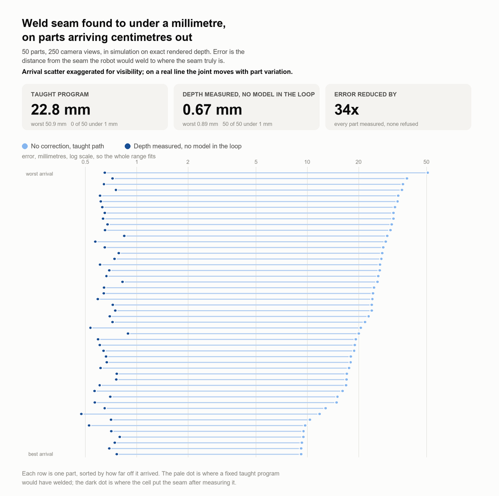
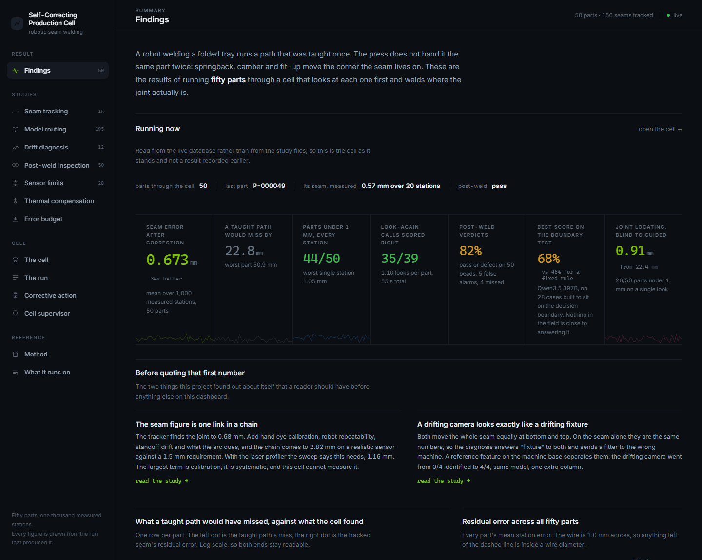
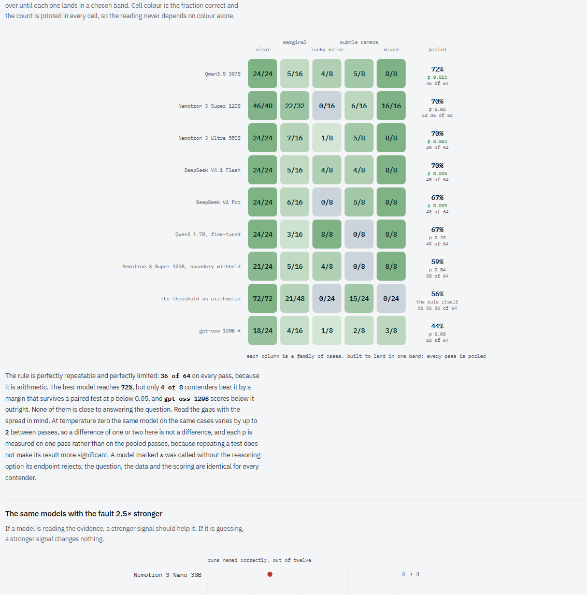
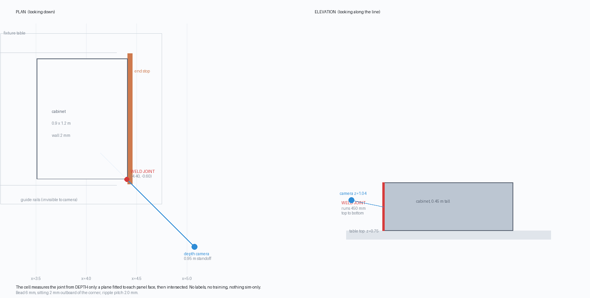
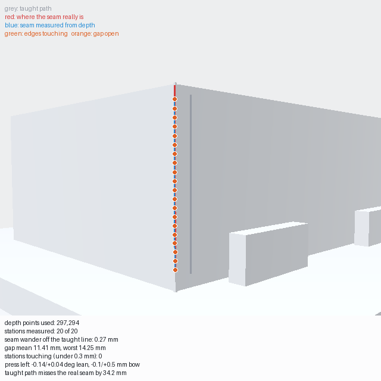

# Self-Correcting Production Cell

A robotic welding cell that photographs every part before it welds, checks its own work
afterwards, and raises the alarm when a machine upstream starts going out of adjustment.

Built for the Nebius x NVIDIA Global AI Hackathon, Physical AI track.



Every row is one part. The pale dot is where a taught program would have welded; the
dark dot is where the cell put the seam after measuring it. Drawn from the campaign
file by `scripts/draw_result_chart.py`, so a number on the chart cannot drift away from
the run that produced it.

## Run it

```bash
pip install -r requirements.txt
uvicorn service.app:app            # every study page is live immediately
python scripts/demo.py --offline   # three seconds, and the cell is running
```

No GPU, no API key and no download. Six parts of real captured depth ship with the
repository, and this runs the actual pipeline over them rather than replaying saved
numbers. A Token Factory key turns on the half that calls a model.



## What was measured

| | Result | Scored against |
| --- | --- | --- |
| Seam tracked along its whole length | **22.8 mm → 0.67 mm**, 50 of 50 parts under 1 mm | the true seam, 1,000 stations |
| Routing to the right model size | 34 of 39 for the smallest model | ground truth, not a larger model's opinion |
| Post-weld inspection | 82% pass or defect on 50 beads | the defect that was injected |
| Thermal compensation | 0.55 mm → 0.03 mm residual | a distortion model calibrated to published figures |
| Which machine is drifting, on easy cases | 16 of 16 | **retired, see below** |
| Which machine is drifting, on hard cases | **best model 72%, a fixed rule 56%** | cases sampled onto the decision boundary |

### If you read three things

**[The test the answer key passes](#the-test-the-answer-key-passes-and-what-replaces-it).**
Every drift score here was measured on cases where the answer is recoverable by
comparing two numbers to a threshold, and four lines of arithmetic score full marks on
them in zero milliseconds. The replacement is a set built by rejection sampling onto
the boundary. Six hosted models were run on it. The best gets 72% against the rule's
56%, one of them scores below the rule, and the fine-tuned model's perfect score turns
out to be an artefact of the easy set. The test itself then turned out to have a hole
in it, which is written up with the rest.



**[A drifting camera looks exactly like a drifting fixture](#a-drifting-camera-looks-exactly-like-a-drifting-fixture).**
Measured on the seam alone the two faults are not similar, they are the same numbers,
to two decimal places. No model fixes that because the information is not in the data.
One reference feature bolted to the machine base does: same model, same prompt, 0 of 4
drifting cameras identified becomes 4 of 4.

**[What the 0.67 mm does not include](#what-the-067-mm-does-not-include).** The tracker
finds the joint to 0.67 mm. Add hand-eye calibration, robot repeatability, standoff
drift and what the arc itself does, and the chain comes to 2.82 mm against a 1.5 mm
requirement. The largest term is calibration, it is systematic, and this cell cannot
measure it.

Every number here was measured. Where a claim turned out to be wrong, it has been
retracted on the spot rather than quietly deleted, with the test that disproved it
printed next to it.

## The problem

A welding robot is taught a path once and then drives that same path on every part.
That works if every part arrives in exactly the same place. They do not.

These parts start as flat sheet metal. The sides are folded up in a press, and every
fold springs back by a slightly different amount, so no two parts come out identical.
The joint that needs welding, which is the line where two folded edges meet, ends up
somewhere different on each one. Across the fifty parts measured here, the taught path
missed the real joint by **23 mm on average and 51 mm at worst**. The weld would land on
flat panel instead of in the joint.

There is a second problem on top of that. The joint is not just in the wrong place, it
is also slightly curved: the press leaves it bowed. So even a robot that found the start
and end of the joint perfectly, and drove a straight line between them, would still
wander off it in the middle.

The usual fixes are to hold tighter tolerances at the press, or to have a skilled
operator watch the line and correct it. Both cost money, neither scales, and neither of
them straightens a joint the press has already bent.

This project does something else: it assumes the part will be in the wrong place, and
measures where it actually is before welding.



The cell, drawn to scale from the same constants the simulation builds from by
`scripts/draw_cell.py`. No renderer is involved: this is the model, not a picture of
it. The camera stands 0.95 m off the joint, the joint runs 450 mm top to bottom, and
the panels are 2 mm sheet.

## What it does

**1. Track the seam, geometrically.** A depth camera looks at the part. The joint is
the line where two folded edges meet, so the cell fits a line to each face and
intersects them, and then walks that measurement up the joint station by station. That
gives the weld path in millimetres directly, with no pixel-to-millimetre calibration to
fit, no labelled images, and nothing to retrain when the part changes, because two
folded edges meeting is still two folded edges meeting.

Tracking the whole length rather than locating a point is the part that matters. The
seam is not merely displaced, it is bent: the press leaves it bowed off the straight
line between its own ends by 0.39 mm on average and 0.94 mm at worst. A program that
locates the part perfectly and then drives a straight path still walks off the joint.



One part from the shipped capture, drawn by `scripts/track_on_model.py` against
`data/demo/manifest.json`, so this picture regenerates on a clone. Grey is the taught
path, red is where the seam really is, and the dots are the measurement at each of the
twenty stations, coloured by whether the edges are touching there or the joint has
opened. The taught path misses this part by 34.2 mm. Everything in the image comes out
of the depth buffer, including the shading: no colour pass is involved at any stage.

**2. Decide whether to believe it, in the cloud.** One look is not evidence. The
measurement comes with signals a real cell has: the angle between the fitted faces, how
evenly the two faces were seen, the fit residual on each, how much of the joint was
covered. An NVIDIA Nemotron model reads those and decides whether the measurement can
be trusted or whether the part should be presented differently and measured again.

What this catches, measured: across fifty parts the worst individual views came back
seventy millimetres out, and every one of them was the part turned forty five degrees,
where the second face goes nearly edge-on and the fitter locks onto a locating pad
instead. Those views do not hide it. They arrive carrying an inlier balance of 0.10 and
a forty five degree included angle where a square corner should read ninety, and the
model reads exactly those signals. Of eighty nine views taken, sixteen were badly wrong
or refused outright, and all sixteen were kept out of the fused answer.

**3. Send each decision to the model that is actually right about it.** Four Nemotron
sizes are served on Token Factory, and they are not interchangeable. Which one a
decision goes to is worked out from signals already in hand, so the routing costs
arithmetic rather than another model call. What the routing should do turned out to be
the opposite of the obvious answer, and the numbers are under Validation.

**4. Choose the weld to suit the joint that is there.** Tracking says where to go; it
does not say how to weld. The gap between the two folded edges is not constant along
the seam, and a schedule that lays a sound weld on a tight fit blows through a gap
twice as wide. The adjustment is counterintuitive: current and voltage come DOWN as the
joint opens, because arc force pushes a puddle through an open root, and the metal
needed to fill the gap is bought by slowing the torch. Past what one pass can bridge
the cell refuses and says the press fit-up needs correcting, rather than laying metal
into a hole and calling it a weld.

**5. Keep looking while it welds.** Everything measured before the arc strikes describes
a cold part. Weld metal contracts as it cools and rotates both sides about their fold
lines, so welding the bottom of a seam moves the top of it long before the torch gets
there. Calibrated against published distortion figures, the corner walks 1.8 mm over one
weld. The sensor leads the arc by 170 mm, and measuring once at that lead costs 0.75 mm,
which is as large as the entire tracking accuracy. That is the arithmetic that says the
cell has to keep looking rather than measure once.

**6. Inspect the weld, in the cloud.** After welding, a second camera photographs the
bead and a vision model returns a verdict with its reasoning: pass, or a named defect.
Defects are deliberately injected in simulation, so every verdict is scored against a
known answer rather than admired.

**7. Supervise, and diagnose which machine to go and touch.** A Nemotron model runs as a
cell supervisor with tools over the production database. Spotting that something is
drifting is the easy half; the half worth money is saying whether it is the press or the
fixture, because they are fixed at opposite ends of the shop. They look alike in a
summary number and quite different in the stream: a fixture moves the whole seam
together, while a press moves the top of the joint and leaves the bottom where it was,
because a bend angle is applied at a fold and multiplied by height. That discriminator
is free to a cell that tracks the whole seam and invisible to one that locates a point.

The supervisor can also search outside the cell. It measures this part; it does not know
what a code permits or what a filler is rated for, and a model's recollection of a
standard is the least trustworthy thing in the building. Those questions are searched
and answered with sources attached, so an operator can check them.

The division is deliberate. Geometry does what geometry is good at, which is turning
surfaces into millimetres. The models do what geometry cannot: judge whether a
measurement deserves trust, judge whether a weld is sound, diagnose a machine from a
run of parts, and explain any of it to the person responsible for the line.

## How Nebius and NVIDIA are used

| Layer | Platform | Model | Runs today |
| --- | --- | --- | --- |
| View planning, inside the control loop | Nebius Token Factory | Nemotron 3 Nano 30B-A3B | yes |
| Shift-level diagnosis, press vs fixture | Nebius Token Factory | Nemotron 3 Super 120B-A12B | yes |
| Cell supervisor agent, with tool calling | Nebius Token Factory | Nemotron 3.5 Lightning | yes |
| Post-weld inspection | Nebius Token Factory | google/gemma-3-27b-it | yes |
| Writing a corrective action brief from fetched documents | Nebius Token Factory | Nemotron 3.5 Lightning | yes |
| Shift-level diagnosis, without a network | trained on Token Factory, runs on the cell's GPU | Qwen3-1.7B + LoRA | yes |
| Looking up standards the cell cannot measure | Tavily | search | yes |
| Reading the documents a fault raises | Tavily | search, then extract | yes |

Four NVIDIA Nemotron sizes are served on Token Factory and this project uses three of
them, for different jobs, because measuring them showed they are not interchangeable.
Nothing in this table is aspirational.

The inspection model is not an NVIDIA one, and it is not a frontier model either. Both
are constraints rather than preferences. Every model the account serves was sent one
clean bead and one with a hole burnt through it, along the real inspection path
(`python scripts/probe_vision_field.py`, result in `data/vision_field.jsonl`):

<!-- vision-field:begin -->
| What happened | Models |
| --- | --- |
| refuses any picture (15 of 23) | deepseek-ai/DeepSeek-V4-Pro, deepseek-ai/DeepSeek-V4-Pro-0813, nvidia/NVIDIA-Nemotron-3-Nano-30B-A3B, nvidia/nemotron-3-super-120b-a12b, nvidia/Nemotron-3-Ultra-550b-a55b, nvidia/Nemotron-3_5-Lightning, NousResearch/Hermes-4-405B, Qwen/Qwen3-235B-A22B-Instruct-2507, Qwen/Qwen3-30B-A3B-Instruct-2507, Qwen/Qwen3.5-397B-A17B, deepseek-ai/DeepSeek-V4-Flash-0731, openai/gpt-oss-120b, zai-org/GLM-5.1, zai-org/GLM-5.2, zai-org/GLM-5.3 |
| takes it, will not judge a rendering (2 of 23) | MiniMaxAI/MiniMax-M3, moonshotai/Kimi-K3 |
| judges it (6 of 23) | deepseek-ai/DeepSeek-V4.1-Flash, zai-org/GLM-5.3-Flash, google/gemma-3-27b-it, moonshotai/Kimi-K2.6, openbmb/MiniCPM-V-4_5, moonshotai/Kimi-K2.7-Code |
<!-- vision-field:end -->

All four Nemotron sizes and every frontier text model refuse the picture before any
model runs. Reasoning about the measurement, which is text, therefore runs on Nemotron;
reasoning about the photograph runs on the best of the models that will look at it.

"Best" is measured. Every model that would take the picture was then given the same
fifty beads and the same question. A model may answer that it cannot judge a bead, and
that is scored in its own column rather than as right or wrong, because on a shop floor
a declined bead is a part someone has to go and look at:

<!-- vision-beads:begin -->
| | Beads judged | Named right | Pass/defect right | False alarms | Missed | Declined | Defect types named | Median time |
| --- | --- | --- | --- | --- | --- | --- | --- | --- |
| **Gemma 3 27B** | 50 of 50 | 31 | 41 | 5 | 4 | 0 | 4 | 2.1 s |
| MiniCPM-V 4.5 | 50 of 50 | 31 | 31 | 0 | 19 | 0 | 0 | 1.8 s |
| Kimi K2.6 | 40 of 50 | 31 | 33 | 0 | 7 | 10 | 1 | 11.2 s |
| DeepSeek V4.1 Flash | 26 of 50 | 17 | 25 | 0 | 1 | 24 | 3 | 5.5 s |
| GLM-5.3 Flash | 21 of 50 | 12 | 19 | 0 | 2 | 29 | 3 | 12.1 s |
| MiniMax-M3 | 1 of 50 | 1 | 1 | 0 | 0 | 49 | 0 | 3.0 s |
<!-- vision-beads:end -->

Gemma judged every bead and named the most defect types. MiniCPM reaches the same
headline score by calling every bead a pass: it never once uses the word defect, so it
raises no false alarms and ships nineteen bad parts. Kimi K2.6 also names 31 right, but
only over the forty beads it would judge, and it needed a 3000-token reasoning budget
and five times Gemma's time to do it. DeepSeek V4.1 Flash is the most accurate of all
when it commits, 25 of 26 on pass or defect, and it commits on barely half the beads.
GLM and MiniMax mostly decline, saying the bead is a rendering. A single accuracy figure
cannot tell these apart, which is why every score in this repository is reported as more
than one number.

One thing the comparison had to be fair about: a reasoning model spends its output
budget thinking before it answers, and under the 400 tokens the inspector sends it came
back with nothing, which the parser scored as a wrong verdict. So a reply that did not
parse and spent its budget reasoning is sent once more with room. The prompt, the
pictures and the scoring never change per model; only the envelope does.

Cosmos is not served on Token Factory at all. Reaching Cosmos Reason or Cosmos Transfer
means self-hosting on Nebius AI Cloud, which is a different platform and a larger piece
of work. It is the obvious next step and no result from it is claimed here.

### One model size does not fit one cell

The obvious architecture is a ladder: a cheap model on routine calls, a large one when
the evidence conflicts. That is what was built, and measuring it took it apart.

Scored against ground truth rather than against the largest model's opinion, on 39
decision points where the simulation knows the answer:

| Model | Correct | Robot moves wasted |
| --- | --- | --- |
| Nemotron 3 Nano 30B | **34 of 39** | 5 |
| Nemotron 3.5 Lightning | 1 of 39 | 38 |
| Nemotron 3 Super 120B | 0 of 39 | 39 |
| Nemotron 3 Ultra 550B | 21 of 39 | 18 |

The smallest model in the family is the most correct one for this decision, and on this
part mix it should be the one that runs. That much holds. The explanation this file
used to give for it does not.

**The larger models were not being over-cautious. They were obeying the prompt.** The
prompt said:

> Accept a single view only if its signals are excellent and no other view is available.

Every part in the campaign starts with exactly one view, and "excellent" is never
defined anywhere in the prompt. Read literally, that sentence instructs a model to ask
for a second look on every part in the set, which is precisely what Super did, 39 times
out of 39. Scoring that as a judgment failure was scoring obedience to an instruction
with no number in it.

Putting the same decisions to the same models with one sentence added, giving the
boundary a number taken from what the cell already treats as a good view rather than
tuned against the answers:

| Model | Prompt as written | Boundary stated |
| --- | --- | --- |
| Nemotron 3 Super 120B | 0 of 39 | **20 of 39** |
| Nemotron 3.5 Lightning | 1 of 39 | **39 of 39** |
| Nemotron 3 Nano 30B | 33 of 39 | **39 of 39** |

The left column reproduces the routing study to the decision: 0 of 39 and 1 of 39 are
exactly what that table reports, because this runs the same cases through the same
planner and scores them the same way. Only the sentence under test changes. The first
version of this script did not do that. It rebuilt the cases and the call by hand, and
returned 18 of 20 for Lightning against the study's 1 of 39, which was a difference
between two harnesses rather than between two prompts. A number that disagrees with the
thing it is meant to explain is not a finding, it is a bug, and it was one.

So the routing decision survives and its justification changes. The small model is still
the right one to run here, and for a reason worth keeping: it reaches the correct call
without needing the boundary spelled out, which is the behaviour you want from the model
that answers every part. But "large models are inherently more cautious" was a story
told about a prompt defect. Every model in the family improves once the boundary has a
number, and two of them go to full marks, which is not what a difference in caution
looks like. A reader entitled to the first table is entitled to this one.

Two properties of the cell also make the small model's answer safe rather than lucky:
accepted views are fused with a median, so one bad view is outvoted before any model is
consulted, and on this part mix there was nothing for a second look to find.

This is the second time this evaluation has been wrong about why. The first version
compared each tier against the largest model and reported that the small one agreed with
it zero percent of the time, which measured conformity rather than quality. Both errors
had the same shape: a number was produced, and the explanation attached to it was never
itself tested.

```bash
python scripts/eval_view_prompt.py --cases 20
```

Where the sizes DO separate is the other job. Asked to read thirty parts of measurements
and say whether a press or a fixture is drifting, the small models answer "press" every
time regardless of the data, and do not improve when the signal is made clearer. The
large ones read it:

| Model | Marginal drift | Clearer drift |
| --- | --- | --- |
| Nano, Lightning | 4 of 12, answered "press" 12 of 12 | 4 of 12, unchanged |
| Super, Ultra | 8 of 12 | 10 of 12 |

So the routing that survives is by task, not by evidence difficulty. A fast judgement
over a handful of numbers goes to the smallest model at about 1.4 seconds. Trend
reasoning across a run of parts goes to a large one. Sending the second job to the small
model produces a confident answer that is the same every time.

### Why there is no detector to harden

The usual sim-to-real problem is that a detector trained on rendered images is good
at rendered images and little else. This project does not have that problem, because
it does not have a trained detector. Finding the seam is geometry: two faces fitted
from the depth buffer and intersected, walked along the joint. There is nothing to
label, nothing to train, and nothing to retrain when the part changes, because two
folded edges meeting is still two folded edges meeting.

What that buys is a shorter path to a real machine. The input is a depth map, and a
depth map from a real sensor and a depth map from a render differ far less than two
photographs do. The appearance gap that defeats trained detectors is largely not on
this path.

What it costs is that the geometry has to be right, and getting it right was most of
the work. Three faults in the capture each produced confident, wrong millimetres
before they were found: a camera near plane clipping the corner out of every depth
image, an end stop standing exactly on the seam, and a sheet thickness no press could
fold. None of them looked like a bug. All of them looked like data.

The simulation does emit depth, segmentation and surface normals alongside each
render, which are the control inputs a world foundation model wants. That is the seed
for photorealistic variants through Cosmos Transfer, and it is the obvious next step.
It has not been run, so no result from it is claimed.

## Validation

The cell runs in a physics simulation, which means ground truth exists for every part.
Where the cell says the seam is can be compared against where the seam actually is.
Scored over full campaigns rather than demonstrated once.

Fifty parts arrive under physics with randomised offset, and the press leaves residual
springback and camber on every folded side. Every arm reads the same renders of the
same parts.

### Following the seam

The measurement that matters: not where the corner is as a point, but where the seam
runs along its length, taken at twenty stations up each part. A thousand measurements
over fifty parts.

| | Mean | p95 | Worst | Sub-millimetre |
| --- | --- | --- | --- | --- |
| Taught path, no correction | 22.80 mm | 36.37 | 50.91 | 0 of 50 |
| Tracked from depth | **0.67 mm** | 0.83 | **0.89** | **50 of 50** |

That is the tracker, on exact rendered depth. It is one link in a chain, and the
whole chain comes to 2.8 mm on a realistic sensor. See "What the 0.67 mm does not
include" below before quoting it as the accuracy of the cell.

Every part tracked, every station, none refused. The worst single station across all
thousand reads 1.05 mm.

A straight path cannot reach this by being aimed better, because the seam itself is not
straight: it bows off the line between its own ends by 0.39 mm on average
and 0.94 mm at worst.

### Locating the corner, and what the routing costs

The narrower question, and where the model sits in the loop.

| | Mean | p95 | Worst | Sub-millimetre |
| --- | --- | --- | --- | --- |
| No correction | 22.41 mm | 36.11 | 50.17 | 0 of 50 |
| One fixed view | 0.91 mm | 1.61 | 1.79 | 26 of 50 |
| Loop on one fixed model | 0.89 mm | 1.61 | 1.79 | 27 of 50 |
| Loop, routed by task | **0.91 mm** | 1.61 | 1.79 | 26 of 50 |

Routing costs 1.00 looks per part against 1.78, which is
44 percent fewer robot moves, and 74 seconds of
model time against 206, for 0.021 mm of accuracy.

The honest reading on the loop itself is that it is not currently earning its cost on
this measure. An earlier run showed a large gap, and that gap closed when three faults
were fixed in the capture: a camera near plane clipping the corner out of every depth
image, an end stop standing on the seam, and a sheet thickness no press could fold.
Those fixes made the single fixed view good. What the loop demonstrably still does is
refuse bad evidence, and what routing does is stop paying a large model to answer a
question the small one already answers correctly.

### What the arc does to the joint

Calibrated against published distortion figures rather than fitted to look good: about
0.25 degrees of angular distortion and 0.94 mm of transverse shrinkage for a weld this
size, angular distortion rising with heat input and falling with the square of the
thickness.

| | |
| --- | --- |
| Corner walks over one weld | 1.84 mm |
| Residual springback the press leaves | 0.11 deg typical |
| Angular distortion the arc adds | 0.25 deg |
| Cost of measuring once at a 170 mm lead | 0.75 mm |

The arc moves the joint by more than the press did, and it does it after the
measurement was taken. The last row is why the sensor cannot look once.

### Diagnosing which machine to touch

Three scenarios where the answer is known: a press drifting, a fixture drifting, and
nothing wrong at all. The control matters, because a diagnostician that always finds
something is not diagnosing, and a control run has to be checked for flatness before it
can be used, since ordinary scatter produces trends by chance.

The short version of the cloud result: this task needs a large model, and the small
ones answer "press" every time, which scores 4 of 12 without reading anything.

That was the finding. It was also a problem, because it put the one question a shop
actually pays for behind a 120B model and a network connection.

**So the model was taught instead of bought.** The cell is a simulation with a forming
model in it, so a run of parts with a known fault costs nothing to make and arrives
already labelled. Six hundred runs were generated, a 1.7B model was fine-tuned on
Nebius Token Factory in four minutes, and the adapter now runs on the workstation beside
the cell with no network at all.

| Model | Where | Result | How it got there |
| --- | --- | --- | --- |
| Qwen3-1.7B, untrained | on the cell | 4 of 12 | answered "none" every time |
| Nemotron 3 Nano 30B-A3B | Token Factory | 4 of 12 | answered "press" every time |
| Nemotron 3.5 Lightning | Token Factory | 4 of 12 | answered "press" every time |
| Nemotron 3 Super 120B-A12B | Token Factory | 8 of 12 | read the evidence |
| Nemotron 3 Ultra 550B | Token Factory | 8 of 12 | read the evidence |
| **Qwen3-1.7B + LoRA** | **on the cell** | **12 of 12** | trained on simulated runs |

The comparison is kept honest by construction. The same generator (`cell/drift.py`)
builds the training runs and the scored runs; the four seeds the evaluation lands on are
excluded from the training set with a margin either side; the system prompt is imported
rather than retyped, so the trained model is not given a better prompt than its
baselines; and reasoning is disabled for it exactly as it was for the Nemotron sizes.
The untrained control on the same base model and the same prompt is the line that says
the training did the work.

One caveat worth stating: the trained model answers in about 4 s on a laptop GPU against
roughly 2.3 s for the 120B in the cloud. It is slower per call and available when the
line is not, and it is asked once a shift, so the wall clock barely matters.

### Where it stops working

Every number above was measured on exact rendered depth, which makes them ceilings
rather than results. A joint finder scored on perfect input has not been scored on
anything, so the whole fifty-part campaign was run again at twenty-eight sensor
degradations, twice over, and the error followed until it broke. The threshold was
fixed before the sweep ran: the wire is 1.0 mm across, so a path further than that
from the joint is not on the joint.

The sensor model is not "add some Gaussian noise". It is the three things that
decide this particular measurement: clustered specular dropout, because folded
sheet steel returns nothing from a face angled away and does it in patches rather
than speckle; flying pixels at depth discontinuities, which matter here more than
anywhere because the discontinuity IS the joint; and range noise scaling with the
square of distance, because disparity resolution is fixed in pixels.

The result inverts the obvious intuition:

| Failure mode | Holds to | Fails at |
| --- | --- | --- |
| Specular dropout | **90% of the frame gone** | never, across the sweep |
| Flying pixels at the joint edge | **90%** | never, across the sweep |
| Range accuracy at one metre | 1.0 mm | **2.0 mm** |

The killer is accuracy, not missing data. The method shrugs off losing most of the
frame and dies on two millimetres of range error.

Chasing that turned up a bug and produced the one algorithmic change in this
repository. The bug: the RANSAC inlier band for the face fits defaulted wider than
the sheet is thick, so one plane could claim a panel's inner AND outer surface and
put its offset between them, biasing the seam by about 1.4 mm. The change: a
station used to fit its two lines from the few hundred points inside a thin slice,
and a short segment constrains a line's ANGLE badly, which is then multiplied out
to the vertex. But the faces are two continuous panels seen in tens of thousands of
points, and a folded panel has one orientation. Only how far out it sits varies,
because springback bows it. So each face is now fitted once from every point it
has, with only its offset free as a low-order polynomial in height.

What that bought, worst station on any part in brackets:

| | Slices alone | Faces fitted once |
| --- | --- | --- |
| Clean | 0.673 mm (1.05) | 0.676 mm (1.03) |
| Range noise 1.0 mm | 0.788 mm (1.89) | **0.690 mm (1.04)** |
| 10% dropout | 0.686 mm (4.63) | **0.648 mm (1.00)** |
| 90% dropout | 1.316 mm (9.22) | **0.655 mm (1.02)** |
| Typical stereo camera | 2.652 mm (8.82) | **1.787 mm (3.67)** |

The mean barely moves on clean data. The tail moves enormously, and the tail is
what matters: a mean inside the wire diameter is perfectly compatible with one
station five millimetres out, and one station five millimetres out is the
burn-through.

**What this does not show is that the method now survives a real camera.** At
typical stereo noise it is still 1.79 mm against a 1.0 mm wire, and the range
accuracy cliff did not move at all, because no estimator averages away a
systematic accuracy limit. The honest reading is that the sweep says which sensor
class the job needs, and it agrees with what production seam trackers actually
use: laser line triangulation at a tenth of a millimetre, not general purpose
stereo at a metre.

### Welding where the joint is going to be

The measurement is cold and the weld is not. Heat put into the bottom of the seam
rotates both folded sides about their fold lines, so the top of the joint walks
inward before the torch reaches it. The thermal model predicted this from the
start, the number was computed and stored, and nothing used it: the path was
driven to the cold measurement, which is where the joint used to be.

Compensating is easy and proving it helps is not, because there is an obvious way
to cheat: predict the distortion with the same model that produces it and the
correction is exact by construction. So the cell compensates with nominal constants
while the metal moves by perturbed ones, which is the situation a real machine is
in.

| Model error | Welding the cold measurement | Welding where it will be |
| --- | --- | --- |
| -40% | 0.330 mm | 0.216 mm |
| nominal | 0.552 mm | **0.034 mm** |
| +100% | 1.103 mm | 0.557 mm |

Compensating beats not compensating from -40% to +100% model error. The curve is
not symmetric and that asymmetry is the practical result: under-modelling leaves
some of the walk behind and is bounded by the distortion itself, while
over-modelling pushes the torch past the joint and is bounded by nothing. A cell
unsure how hot its own weld runs should under-correct on purpose.

### Does this only work for welding?

The loop generalises and none of the numbers do. Stated without the welding it is
three moves: measure the part rather than trusting the program, at the place the
tool will touch it; schedule the process to what was measured, station by station,
and refuse where the measurement says the process cannot work; and read the run
rather than the part, because correcting every part hides the machine that made
them wrong.

Press braking is the closest case and the strongest evidence, since high-end
brakes already close exactly this loop with angle sensors. Self-pierce riveting
needs the same stage two, with the feature a point rather than a line and the die
chosen from local stack thickness. Adhesive and sealant dispensing is nearly
isomorphic: a bead following a flange that moved, with flow rate following the gap.

What does not carry across is any number in this repository. Each process needs its
own feature to find, its own process model in place of `cell/weld_params.py`, its
own defect vocabulary and its own calibration. Claiming otherwise would be the same
mistake as quoting an accuracy figure measured on exact depth.

### What the 0.67 mm does not include

That figure is true about the tracker and would be a misrepresentation of the cell.
Published work on vision guided welding is explicit that achieved accuracy depends
on the whole chain: sensor resolution, calibration quality, standoff stability,
part surface, robot repeatability. This project measured two of those carefully and
was silent about the rest.

Systematic terms add. Independent random terms combine in quadrature. Which of the
two a term is decides whether making more parts helps, and several of these are
systematic.

| | Total | Meets 1.5 mm? |
| --- | --- | --- |
| What the seam study alone suggests | 0.68 mm | yes |
| Perfect sensor, nothing compensated | 2.23 mm | no |
| Typical stereo camera, compensated | 2.82 mm | no |
| Laser profiler, compensated | **1.16 mm** | yes |

Industrial vision guidance for weld tracking is asked for about 1.5 mm. Only the
last row meets it, which is the same conclusion the sensor sweep reached from the
other direction.

The largest single term is **hand eye calibration at 0.85 mm**: systematic, bigger
than the entire tracking error, taken from published residuals rather than measured
here, and not fixable by this cell. Every term in `cell/error_budget.py` carries
where its number came from. The first version of that file labelled its own laser
row "measured here" when it is a published figure, which is a fair demonstration of
how quietly that goes wrong.

### A drifting camera looks exactly like a drifting fixture

This one is worse than an omission, because the cell answers it confidently.

A fixture going off moves the part. A camera going off moves the measurement. Both
appear in the seam as the whole joint translating, by the same amount at the bottom
and the top, with the tilt flat. Measured on the seam alone they are not merely
similar, they are the same numbers: across four runs the discriminators differ by
0.00. So the drift diagnosis answers "fixture" to both and would send a fitter to
re-shim a fixture that is fine while the camera mount goes on moving.

No model fixes that, because the information is not in the data. What fixes it is an
instrument: a reference feature bolted to the machine base rather than to the
fixture, which the same camera reads on every part. Nothing about the press or the
fixture can move it; only the camera can.

Asked to name one of four causes, Nemotron 3 Super 120B-A12B:

| | Score | Drifting camera identified |
| --- | --- | --- |
| On the seam alone | 8 of 16 | **0 of 4** |
| With the reference | **14 of 16** | **4 of 4** |

Same model, same prompt structure, one extra column. What was missing was not
intelligence. And it is the same instrument that would catch the calibration term
above going out, so the two findings are one blind spot seen from two directions.

Once the instrument existed, the small model was retrained on the harder problem:
four causes rather than three, with the reference column, on eight hundred runs
generated away from the same held-out seeds.

| Model | Where | Four-way score | The two that look alike |
| --- | --- | --- | --- |
| Nemotron 3 Super 120B, seam only | Token Factory | 8 of 16 | 4 of 8 |
| Nemotron 3 Super 120B, with reference | Token Factory | 14 of 16 | 6 of 8 |
| Qwen3-1.7B + LoRA, with reference | the cell's own GPU | 16 of 16 | 8 of 8 |

**That 16 of 16 does not mean what it looks like, and the row is left unbolded for
that reason.** It was measured on a test set with no hard case in it. Every run in
it sits at least 0.58 away from the decision boundary and most sit one to two away,
so the answer is recoverable by comparing two numbers to a threshold. Four lines of
arithmetic with no model in them also score 16 of 16 on that set, in zero
milliseconds. A score a ruler can match is not evidence of diagnosis, and the
section below is the test built to find that out.

The three-cause result earlier in this file is kept rather than replaced. Those
models were scored on that question, and restating their numbers against a harder
one they never saw would be exactly the sort of thing the rest of this file exists
to avoid.

The honest cost is time: about 5.7 s on a laptop GPU against roughly 1.6 s for the
120B in the cloud. For a question asked once a shift on a machine that may have no
network, that is the right side of the trade, and it is a different trade from the
one the per-part decisions make.

That figure took two goes to measure. The first run reported 17 s, which was the
measurement rather than the model: the latencies fell monotonically from 39 s to
9 s across the run, which is a laptop GPU starting at a low clock and ramping. A
throwaway inference before timing, which is ordinary practice for GPU benchmarking,
brought the median to 5.7 s with the scores unchanged.

Worth being precise about where this runs, because it is the one part of the project
that does not run on Nebius. The LoRA was trained on Token Factory and the base is
pulled from Hugging Face; the merged adapter then runs on the workstation beside the
cell. Everything it is compared against is a Token Factory API call. "Trained on
Nebius, runs at the edge" is the accurate description, and no edge score in this file
should be read as a Token Factory number.

### The test the answer key passes, and what replaces it

Every drift score above it is measured on cases that are not hard. The runs were
generated by injecting a fault and checking it showed, so the closest one sits 0.58
away from the decision boundary and there is no marginal case anywhere in the set.
That has two consequences worth stating plainly. A fixed rule cannot fail on it: the
boundary written out as four lines of arithmetic scores 16 of 16 in zero
milliseconds. And the differences between models on it were largely differences in
how well each guessed a boundary the prompt never named, which is why stating the
boundary moved a frontier model from 9 of 16 to 16 of 16.

So a second set was built where a ruler and a diagnostician come apart. Cases are
generated by rejection sampling until they land in a chosen band, in five families:

| Family | What it is |
| --- | --- |
| `clear` | a fault well past the threshold, kept as a control |
| `marginal` | a real fault whose trend does **not** clear the threshold |
| `lucky_noise` | nothing injected, but scatter pushes a channel over the line |
| `subtle_camera` | a camera creeping near the line rather than far past it |
| `mixed` | a press and a fixture going out together |

Every arm is asked the same question with the same data and scored the same way. What
is allowed to differ is the envelope, because which API options an endpoint accepts is
a property of the endpoint rather than of the model's judgment, and adapting the
question per model until each looks good would not be a benchmark. Both halves of that
were learned the hard way here: one model rejects the reasoning option this project
sends and its refusals were recorded as 0 of 28, and another was addressed by an
identifier that does not exist and also came back 0 of 28. Neither is a score. A pass
whose endpoint returned errors instead of answers is dropped rather than published, and
an arm that was called without an option it refuses is marked as such.

On `mixed`, naming either genuine fault counts. Both machines need touching and
naming one sends a fitter somewhere useful; naming a cause that is not happening
does not.

Six hosted models were run on it, every one with the same prompt, the same data and
the same scoring, alongside the rule and the model running at the edge. Passes are
pooled rather than picked, and each arm's per-pass scores are shown, because the
spread matters more than the ranking:

| Arm | Score | Rate | Beats the rule on | Loses on | p |
| --- | --- | --- | --- | --- | --- |
| Qwen3.5 397B | 46/64 | **72%** | 12 | 2 | **0.013** |
| Nemotron 3 Ultra 550B | 45/64 | 70% | 9 | 0 | **0.004** |
| DeepSeek V4.1 Flash | 45/64 | 70% | 12 | 3 | **0.035** |
| Nemotron 3 Super 120B | 44/64 | 69% | 12 | 4 | 0.077 |
| DeepSeek V4 Pro | 43/64 | 67% | 8 | 1 | **0.039** |
| Qwen3-1.7B + LoRA, at the edge | 43/64 | 67% | 16 | 9 | 0.230 |
| Super 120B, boundary withheld | 38/64 | 59% | 13 | 11 | 0.839 |
| **The threshold as arithmetic** | 36/64 | 56% | | | baseline |
| gpt-oss 120B | 28/64 | 44% | 4 | 12 | 0.077 |

Sixty-four cases, eight per family and scenario pair over eight seeds. The last three
columns are the paired comparison against the rule on the same cases: how many the arm
got right where the rule did not, how many the other way, and the exact McNemar p.
Concordant cases say nothing about which arm is better and are excluded.

Four things fall out of it, and the first is about the test rather than the models.

**The first version of this test had a hole in it, and said nothing.** A clear camera
drift generated zero cases out of an intended eight, so one of the eight family and
scenario pairs was simply absent and the header announced "8 pairs" regardless. The
cause was a guard that looked reasonable: a case should be loud on the channel its
fault moves and quiet on the rest. But a camera moves the MEASUREMENT, so it shows on
the reference and as an apparent shift of the whole seam, and that second channel is
the entire confound the section above spends a study on. The guard threw every camera
case away. Filling the hole moved the rule's baseline from 46% to 56%, because a clear
camera is easy for a rule, so the first version also flattered every model against it.
The generator now knows which channels each fault is supposed to move, the runner
prints the count for every pair and says so loudly when one is empty, and a test
asserts that no pair is ever silently absent.

**Read the gaps against the spread and the p value, not against each other.** At
temperature zero the same model on the same cases came back 18, 16, 17 and 16 across
four passes of the earlier set. Two arms differing by one or two are not differing.
Three of the six hosted models beat the rule at p below 0.05 on the paired test, and
Nemotron 3 Super 120B, which is the model this project actually routes to, is not one
of them: 69% against 56% at p = 0.077. On the earlier 28 case set no arm at all
cleared p = 0.05, and an earlier draft of this section claimed the margin as a finding
anyway. Pooling repeated passes would have turned that p = 0.07 into p = 0.004, which
is significance manufactured out of a rerun; the comparison is made on one pass.

**The fine-tuned model's 16 of 16 was an artefact of the easy set.** Here it scores 67%
and answers "none" to 3 of 16 marginal cases and none of the 8 subtle camera cases. It
learned the threshold and very little past it, which is exactly the behaviour an easy
set cannot distinguish from diagnosis, and its margin over the rule is not significant
(p = 0.23). It is still the right thing to run for the clear cases it was built for, at
the edge, with no network. It is not a better diagnostician than the model it was
distilled from.

**Where the models earn their place, and where the rule wins.** The gap is in the two
families a threshold cannot reach: 8 of 8 on runs with two machines drifting, where the
rule scores 0 of 8 because seeing two channels move gives it no branch and it falls
through to "nothing wrong", and up to 4 of 8 on lucky noise, where the rule scores 0 of
8 because a channel over the line is all it looks at. The rule wins on subtle camera,
5 of 8 against 3 to 5 for the models and 0 of 8 for both the edge model and the 120B
with the boundary withheld. A camera creeping just past the line is exactly the case
where applying the boundary mechanically is right and reasoning around it is wrong.
Nothing here is close to answering the question, on four possible answers.

One implementation note that belongs here rather than in a commit message. On these
runs the 120B twice answered `reference`, which is a column in the data and not one
of the four causes it was asked to choose between. Scored by string comparison that
is simply wrong; scored honestly it is a different failure, a model answering a
question nobody asked. Every evaluation in this repository now routes replies through
one validator that rejects anything outside the answer space and records it as
`out_of_vocabulary`, so an unparseable reply, a refusal, and an invented category are
three distinct outcomes rather than all silently counted as a wrong diagnosis.

```bash
python scripts/eval_hard_drift.py --per-family 8
```

### Reproducing all of it

Every figure in this file is generated rather than pasted, so a stale one is a command
away from being correct:

```bash
python scripts/make_figures.py
```

The studies behind them:

```bash
python scripts/run_seam_campaign.py --manifest data/cap50/manifest.json
python scripts/run_campaign.py --manifest data/cap50/manifest.json --no-post --routed
python scripts/eval_router_truth.py --campaign data/campaign50.jsonl
python scripts/eval_drift.py --parts 30 --runs 4
python scripts/draw_result_chart.py --campaign data/seam_campaign.jsonl

# every other model that will take a picture, on the same beads
python scripts/probe_vision_field.py
python scripts/run_inspection.py --no-post --model openbmb/MiniCPM-V-4_5 --out data/inspections_minicpm.jsonl
python scripts/run_inspection.py --no-post --model moonshotai/Kimi-K2.6 --out data/inspections_kimi.jsonl
python scripts/run_inspection.py --no-post --model zai-org/GLM-5.3-Flash --out data/inspections_glm.jsonl
python scripts/run_inspection.py --no-post --model MiniMaxAI/MiniMax-M3 --out data/inspections_minimax.jsonl
python scripts/run_inspection.py --no-post --model deepseek-ai/DeepSeek-V4.1-Flash --out data/inspections_deepseek.jsonl

# train the shift diagnosis, then score it on the cell's own GPU
python scripts/make_drift_dataset.py --train 600 --val 80
python scripts/finetune_drift.py --launch
python scripts/finetune_drift.py --watch
python scripts/finetune_drift.py --fetch
python scripts/eval_drift_edge.py
python scripts/eval_drift_edge.py --base-only     # the untrained control

# turn the faults this run found into cited corrective action briefs
python scripts/raise_briefs.py

# where the perception stops working, both arms
python scripts/eval_robustness.py --no-refine --out data/robustness_slices.jsonl
python scripts/eval_robustness.py --out data/robustness_refined.jsonl

# whether welding where the joint will be beats welding where it was
python scripts/eval_compensation.py

# the camera-versus-fixture confound, and the instrument that resolves it
python scripts/eval_confound.py

# retrain the edge model on four causes, and score it on the cell's own GPU
python scripts/make_drift_dataset.py --with-camera --train 800 --val 100 \
    --out data/finetune_camera
python scripts/finetune_drift.py --launch \
    --train data/finetune_camera/drift_train.jsonl \
    --val data/finetune_camera/drift_val.jsonl --suffix drift-four-way
python scripts/finetune_drift.py --watch
python scripts/finetune_drift.py --fetch
python scripts/eval_drift_edge.py --with-camera
python scripts/eval_drift_edge.py --with-camera --base-only
```

Seam finding is geometric: two faces fitted from depth and intersected, walked along
the joint. There is no trained model in that path, nothing to label and nothing to
retrain when the part changes.

## Architecture

```
  IN THE CELL                             CLOUD (Nebius Token Factory)
  -----------                             ----------------------------
  part arrives, settles under physics
        |
        v
  depth camera, one fixed pose
        |
        v
  locate the part, then track the    --->   Nemotron Nano: is this view worth
  seam station by station up the             believing, or present the part
  joint: two faces fitted from                and look again?
  depth and intersected                                |
     ^                    |                            |
     |                    |                            |
     +-- part re-presented about the joint axis <------+
                          |
                    fuse accepted views
                          |
                          v
     gap at every station --> weld schedule per station
                          |   arc down, travel slowed, or refuse the fit-up
                          v
                    weld the measured path
                          |
     the arc rotates both sides as it goes, so the joint keeps moving:
     the sensor leads the arc and keeps measuring rather than trusting
     the cold reading
                          |
                          v
  post-weld capture  -------------->      vision model -> pass, or a named
                          |                               defect, with reasoning
                          v
  FastAPI service + SQLite  <---------->  Nemotron Super: across a run of parts,
        |                                  is the PRESS drifting or the FIXTURE?
        |                                  a press tilts the seam, a fixture
        +--> operator dashboard            shifts it
        +--> Nemotron supervisor, reading the same rows through tools,
             and searching outside the cell for anything it cannot measure

  Ground truth exists for every part, so every number above is scored, not shown.
```

Every measurement, verdict and decision lands in one database. The dashboard and the
agent read the same rows, so what the operator sees and what the agent reasons over
cannot drift apart.

## Repository layout

```
cell/       cell geometry, press forming and drift, weld thermal distortion,
            adaptive weld parameters, depth seam tracking, Isaac simulation
brain/      Nebius client, model router, view planner, inspection prompt,
            supervisor agent and its tools, outside lookup
service/    FastAPI service, database schema, API
dashboard/  operator web UI
scripts/    campaign runners, evaluations, figures, cell visualisation
docs/       platform notes and measured results
tests/      unit tests
```

The pieces that carry the argument:

| File | What it settles |
| --- | --- |
| `cell/seam_track.py` | follows the seam along its length instead of fitting it straight |
| `cell/forming.py` | what a press in spec still leaves on a folded side, and what a drifting one leaves |
| `cell/thermal.py` | what the arc does to the joint while it is welding it |
| `cell/weld_params.py` | choosing the weld to suit the gap that is actually there |
| `brain/router.py` | which Nemotron each decision goes to, and why that is not the obvious answer |
| `scripts/eval_router_truth.py` | scores every model size against ground truth rather than against each other |
| `scripts/eval_drift.py` | press or fixture, with a control |

## Setup

Requires Python 3.12 and a Nebius Token Factory API key.

```bash
git clone <this-repo>
cd self-correcting-cell
python -m venv .venv
.venv/Scripts/activate        # Windows
# source .venv/bin/activate   # Linux and macOS
pip install -r requirements.txt
```

Copy the environment template and fill in your key:

```bash
cp .env.example .env
```

Verify cloud access before anything else:

```bash
python scripts/hello_nemotron.py
```

Run the service and open the dashboard at http://127.0.0.1:8000:

```bash
uvicorn service.app:app --reload
```

It starts empty, and one command fills it:

```bash
python scripts/demo.py
```

That runs the real pipeline over `data/demo`, six parts of captured depth that ship
with this repository, and posts what it finds. It does as much as it can with what
you have: seam tracking and weld scheduling need nothing but the depth frames and
finish in about three seconds, and the look-and-judge routing, the post-weld
inspection and the cited briefs each need a key. Add `--offline` to run only the half
that calls nothing.

The demo writes under `data/demo_run/` rather than over the campaign files in `data/`,
which are the evidence for the numbers in this README and are not the demo's to
overwrite.

Six parts is a demo, not the result. The fifty-part campaign behind the tables needs
the full capture, which is about 900 MB and is not in git:

```bash
python scripts/run_seam_campaign.py --manifest data/cap50/manifest.json
python scripts/run_campaign.py --manifest data/cap50/manifest.json --routed
python scripts/run_inspection.py --manifest data/cap50/manifest.json
```

### What the demo capture costs

The raw depth frames are float32, 1.6 MB each, which is why a full capture cannot be
carried in a repository. The shipped frames are quantised to uint16 over the near
field and gzipped, 49 MB of depth into 5 MB on disk. That is only allowed if the seam
that comes out is the same seam, so `scripts/make_demo_capture.py` tracks every part
from the raw frame and again from the packed one and prints the difference. The worst
station moves by **0.13 mm**, against a tracked seam accuracy of 0.68 mm and a sensor
noise floor above both.

The dashboard then shows the seam itself: the tracked path against the straight line
a taught program drives, the gap at every station, the heat the torch is putting in,
and which Nemotron answered each decision and why.

The simulation half, which produces the captures in the first place, requires Isaac
Sim 6.0 and is run with its bundled interpreter. Nothing above needs it. Capture in batches of ten rather than one run of fifty; the
Replicator graph grows as parts times frames and a single large capture stalls in
graph construction. `scripts/merge_manifests.py` stitches the batches.

## Prior work

The joint-finding and correction concept was validated by the author in an earlier
project, published at
[vision-corrected-welding](https://github.com/harshal-96/vision-corrected-welding).
Everything in this repository was built during the hackathon submission period: the
press forming and drift model, seam tracking along the length of the joint, the weld
thermal distortion model, adaptive weld parameters from the measured gap, the view
planner that puts a reasoning model inside the control loop, the task-based model
router and the evaluations that overturned its first design, the press-versus-fixture
diagnosis, the post-weld inspection station and defect injection, the cloud inspection
model, the supervisor agent with its tools and outside lookup, the database and
service, and the dashboard. The earlier work is the starting point, not the
submission.

## License

Apache License 2.0. See [LICENSE](LICENSE).
